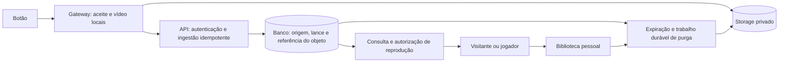
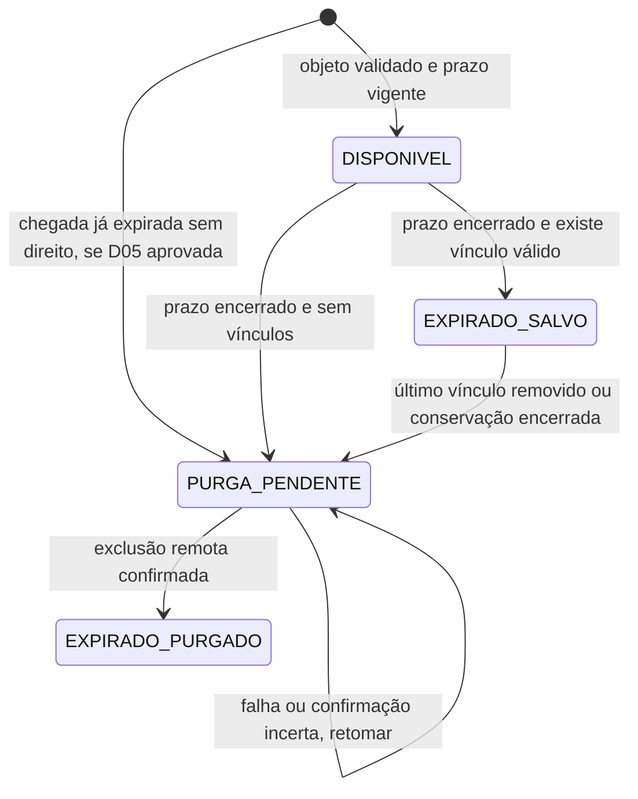

# ClickLance — Overview e refinamento do backend

Data: 15/10/2026. Estado: levantamento revisado para discussão, anterior à implementação.

**Decisão confirmada pelo responsável pelo produto nesta revisão:** o primeiro backend atenderá um **piloto gratuito com biblioteca pessoal**. Pagamentos ficam para uma fase seguinte. Isso substitui a compra como condição de acesso no piloto, mas não resolve o modelo comercial definitivo.

**Leitura rápida:** já existem 14 RF, 23 RN, 5 RNF e 12 histórias do backend. A base cobre cadastro, ingestão, consulta, conta, biblioteca e limpeza. Entretanto, os três documentos antigos não acompanharam o gateway v1 e deixam decisões de autorização, tempo, conservação e falhas sem contrato suficiente. Este documento mapeia todos esses itens e propõe seu refinamento. As pastas `backend/` e `frontend/` estão vazias nesta revisão; o DDL existe apenas como exemplo documental.

## 1. Fontes, evidência e precedência

| Fonte | Uso nesta revisão | Limite |
|---|---|---|
| [Visão do produto v0.1](documento_visao_produto_replay_quadras_v0_1.pdf) | Objetivo original, RF01–RF12, RNF01–RNF06, atores e possibilidades comerciais. | Levantamento histórico; compra e partida formal não equivalem ao escopo do piloto. |
| [Requisitos do MVP](requisitos_e_regras_mvp.md) | Inventário RF-MVP-01–14, RN-MVP-01–23 e RNF-MVP-01–05. | Contém contratos anteriores ao gateway v1. |
| [Histórias e endpoints](historias_de_usuario_e_endpoints.md) | US-01–12, critérios e rotas originalmente propostos. | As quatro sprints e exemplos precisam de atualização antes de implementar. |
| [Modelagem de dados](modelagem_banco_de_dados.md) | Seis entidades e DDL inicial proposto. | Ainda não é uma migration executável e não contempla os novos invariantes. |
| [Contrato cloud v1](contrato_cloud_gateway_v1.md) | Integração que o cliente do gateway já utiliza. | Verificada com simuladores; backend/AWS reais pendentes. |
| [Contrato botão/gateway](contratos_gateway_botao.md) | Separação entre clique, aceite local, janela de vídeo e registro cloud. | Valores físicos ainda dependem de homologação. |
| [Parecer de 13/10](review_consultoria_2026-10-13.md) | Riscos de produto e falhas de desenho que precisam de requisitos. | Achados sobre o código são históricos; parte do Edge foi corrigida depois. |
| [Homologação de 15/10](homologacao_2026-10-15.md) | Evidências atuais e pendências do gateway. | Os 67 testes reportados são do gateway; não verificam um backend existente. |
| `gateway_captura/src/persistent_pipeline.py` e `remote_config.py` | Conferência direta dos payloads, confirmações, erros e configuração aceitos pelo cliente. | Leitura estática nesta revisão; não houve nova execução de testes. |

Convenções:

- **Existente:** intenção já documentada, sem significar implementação ou aprovação de todas as suas consequências.
- **Compatibilidade v1:** comportamento exigido para integrar com o cliente presente no repositório.
- **Proposto:** refinamento recomendado nesta revisão; ainda não é uma decisão aprovada de produto.
- **Pendente:** resposta que precisa ser fechada antes de implementar o comportamento dependente.
- Os IDs existentes são preservados. `RF-MVP-15+`, `RN-MVP-24+` e `RNF-MVP-06+` abaixo são novos itens propostos. `RF01` da visão e `RF-MVP-01` são namespaces diferentes.

Este documento passa a ser o ponto de entrada da revisão. O contrato v1 continua sendo a referência da integração existente. As propostas não alteram automaticamente os contratos, o gateway ou os documentos históricos. Depois das decisões, atualizar requisitos, API e modelo em conjunto.

## 2. Overview do produto e limites do piloto

O jogador marca uma jogada pelo botão sem precisar de conta naquele instante. O gateway aceita e persiste o evento localmente, produz o clipe da janela original, envia um objeto privado e informa o backend. O backend associa o evento à empresa/quadra do dispositivo autenticado. A plataforma oferece busca por quadra, data e horário, reprodução conforme a política de acesso e salvamento na biblioteca de uma conta global.

| Área | Enquadramento para o primeiro backend |
|---|---|
| Empresas, quadras e dispositivos | Cadastro e operação com autorização administrativa desde a primeira entrega. |
| Gateway | Contrato v1; geração/corte do vídeo permanece no Edge. |
| Organização dos lances | Faixas de gravação por horário; não existe entidade de partida no MVP atual. |
| Jogador | Conta única que pode salvar lances autorizados de diferentes empresas. |
| Biblioteca | Incluída no piloto confirmado. Prazo, cotas e remoção ainda pendentes. |
| Cobrança | Fora do piloto por decisão confirmada; backlog futuro preservado na seção 12. |
| Acesso aos vídeos | Política pendente: visitante, login obrigatório ou participantes autorizados. Storage privado em todos os casos. |
| Implantação física | Proposta inicial: uma câmera/quadra/dispositivo por instância de gateway. Confirmar capacidade do piloto; cadastro multiempresa não comprova captura multicâmera. |
| Operação | Rastreabilidade, recuperação de purga e procedimento de suporte antes de usar imagens reais. |
| Expansões | Gestão formal de partidas, múltiplos ângulos, domínios personalizados e planos comerciais precisam de escopo próprio. |

Um slot de 20h–21h é um filtro. Ele não prova que todos os lances pertencem ao mesmo jogo ou ao usuário que os salvou. Um jogo de 20h30–21h30 pode exigir consulta a dois slots.

## 3. Divergências que precisam ser corrigidas antes do código

| Tema | Documentação anterior | Refinamento necessário | Referências |
|---|---|---|---|
| Identidade | Eventos até cinco segundos são o mesmo lance. | `evento_id` estável e unicidade no banco; cinco segundos é cooldown local. IDs diferentes não se fundem pelo horário. | RF-MVP-07; RN-MVP-14; US-05. |
| Payload | `video_url`, sem identidade do evento. | `contrato_versao`, `evento_id`, `dispositivo_id`, `quadra_id`, timestamp com offset e `objeto {bucket,key,sha256}`. | RF-MVP-05/08; contrato v1. |
| Confirmação | Respostas com `id` ou `lance_id`, sem checksum. | Sucesso só após commit durável; eco obrigatório de `evento_id` e `sha256`, inclusive na repetição. | US-05; cliente `CloudGateway.register`. |
| Configuração | `duracao_segmento_segundos` e `segmentos_concatenar`. | Envelope exato `version`, `active`, `settings`; janela antes/depois independente da segmentação. | RF-MVP-04; RN-MVP-11; cliente `RemoteConfig.validate`. |
| Storage | URL direta e extração de chave. | Referência estruturada autorizada e objeto privado; endereço temporário emitido após autorização. | RN-MVP-18/20; US-08/11. |
| Administração | “Aberta no MVP / Admin”. | Identidade e permissão de administrador verificadas em todas as operações de cadastro/configuração. | US-01–03. |
| Expiração | Status suficiente ou cron como única barreira. | Verificar tempo de expiração em toda consulta e emissão de acesso; cron atrasado não prolonga visibilidade. | RF-MVP-09/10/14; RN-MVP-17. |
| Biblioteca | “Para sempre” e salvamento sem limite. | Política explícita de conservação, cota e encerramento; acesso não é propriedade exclusiva da imagem. | RN-MVP-19/23; US-10. |
| Consistência | Upload e POST “atômicos”. | S3 e banco têm falhas parciais; retomada idempotente e reconciliação são necessárias. | Decisão arquitetural 3 do MVP. |
| Tempo | Exemplos locais sem offset e UTC misturados. | Instantes com offset, armazenamento UTC, fuso IANA da quadra e slots `[início,fim)`. | RN-MVP-09/10/16; US-07. |
| Envio tardio | Todo novo registro é `DISPONIVEL`. | Definir chegada após expiração sem alterar o instante original nem provocar retentativa infinita. | RN-MVP-15/16. |
| Monetização | Compra na visão; salvamento gratuito no MVP. | Piloto gratuito confirmado. Não construir checkout nesta fase. | RF10/11 da visão; seção 12. |
| Schema | FKs independentes e índice temporal não único. | Unicidade de evento/objeto e coerência entre dispositivo, quadra e empresa, além de trabalhos duráveis de purga. | Modelagem inicial. |

## 4. Atores e matriz de acesso proposta

Os papéis administrativos são uma proposta; o vínculo com a empresa precisa existir no modelo. Autenticar um JWT não determina sozinho quais recursos podem ser administrados.

| Ator | Poder esperado | Restrição |
|---|---|---|
| Administrador da plataforma | Cadastrar empresas, conceder administração e atender operação global. | Ações privilegiadas auditadas; bootstrap controlado, sem cadastro público de admin. |
| Administrador da empresa | Gerir quadras, dispositivos e configurações da própria empresa. | Não pode conceder a si mesmo administração global nem acessar operação de outra empresa. |
| Técnico | Provisionar instalações explicitamente autorizadas. | Proposta: papel separado pode ser adiado; usar administrador autorizado no piloto, sem conta genérica privilegiada. |
| Visitante | Descobrir quadras e, se aprovado, consultar/reproduzir lances vigentes. | Não salva lances e não acessa bibliotecas. Política pública ainda pendente. |
| Jogador | Gerir a própria conta e biblioteca; salvar lances para os quais possui acesso. | Não recebe permissão administrativa nem acesso a vídeo privado de outro jogador. |
| Dispositivo/gateway | Consultar a própria configuração e registrar os próprios eventos. | Token de dispositivo não vale como sessão de usuário ou administrador. |
| Worker de limpeza | Processar trabalhos autorizados de exclusão. | Acesso de deleção separado do upload; não aceita bucket/chave arbitrários de usuários. |

Conta do jogador é global; dados operacionais pertencem a uma empresa. Uma biblioteca pode conter lances de várias empresas sem expor dados administrativos dessas empresas.

## 5. Inventário completo dos 14 RF existentes

Todos estão **planejados no backend**, sem implementação cloud verificada nesta revisão. A coluna de aceite descreve o resultado que precisa ser demonstrado após implementar. Alterações indicadas são propostas, exceto a compatibilidade necessária com o gateway v1.

| ID / história | Função já mapeada | Refinamento | Aceite essencial |
|---|---|---|---|
| RF-MVP-01 / US-01 | Cadastrar empresa. | Exigir admin da plataforma; retenção validada; fuso padrão e status explícitos. “2 a 7” hoje é exemplo, não limite aprovado. | Visitante e admin de outra empresa não criam empresas; valores fora da política são recusados. |
| RF-MVP-02 / US-02,06 | Cadastrar quadra. | Gerir/listar/editar/inativar com escopo da empresa; definir fuso e catálogo público. | Empresa A não altera quadra B; catálogo omite recursos sem visibilidade. |
| RF-MVP-03 / US-03 | Cadastrar dispositivo e emitir token. | ID compatível com CL1 (1–32 caracteres permitidos); vínculo de origem controlado; rotação/revogação. | Token aparece somente na emissão; hash no banco; credencial de um dispositivo não autentica outro. |
| RF-MVP-04 / US-04 | Sincronizar configuração. | Entregar envelope v1 exato e parâmetros aceitos no cliente; versões publicadas rastreáveis. | Gateway atual aceita resposta válida; chave desconhecida não é publicada; eventos antigos preservam contexto. |
| RF-MVP-05 / US-05 | Receber lance autenticado. | Receber contrato v1; validar identidade, campos, origem e referência privada. | Payload real do cliente é aceito e confirmado somente após persistência; origem incorreta é recusada. |
| RF-MVP-06 / US-05 | Resolver empresa/quadra. | Derivar do dispositivo autenticado e confrontar `quadra_id` informado; manter origem histórica. | Campo adulterado não muda destino; IDs de outra empresa não são aceitos. |
| RF-MVP-07 / US-05 | Não duplicar lances. | Substituir proximidade temporal por `evento_id`, constraint e comparação de conteúdo imutável. | Reenvios concorrentes geram um registro; conteúdo divergente retorna 409; eventos distintos próximos continuam distintos. |
| RF-MVP-08 / US-05 | Registrar e calcular expiração. | Guardar evento, bucket, chave, checksum, instante recebido e política aplicada; tratar chegada tardia. | Repetição mantém expiração original; mudança de política não a altera silenciosamente. |
| RF-MVP-09 / US-07 | Buscar por quadra/data/horário. | Paginação; fuso; filtros determinísticos e limites; disponibilidade calculada pelo tempo. | Borda de slot aparece uma vez; data local é correta; cron parado não expõe expirados. |
| RF-MVP-10 / US-08 | Consultar lance por ID. | Mesma autorização da grade/biblioteca; metadados não incluem URL permanente do arquivo. | Expirado salvo por A não fica disponível para B pelo ID; inexistente/inacessível não revela dados privados. |
| RF-MVP-11 / US-09 | Cadastro e autenticação. | Conta global, normalização documentada de email, conta inativa, recuperação e encerramento de sessão. | Email equivalente não cria conta duplicada; senha nunca retorna; conta inativa não obtém acesso válido. |
| RF-MVP-12 / US-10 | Salvar na biblioteca. | Autorização, prazo, cota pendente, unicidade e coordenação com purga; repetição com sucesso estável. | Novo vínculo só antes da expiração; repetição de vínculo existente não duplica, mesmo após expiração; disputa com purga não produz biblioteca quebrada. |
| RF-MVP-13 / US-11 | Consultar biblioteca. | Paginação, autorização por dono e reprodução separada; conservação conforme política a decidir. | A não lista biblioteca de B; expirado salvo continua acessível somente aos autorizados, salvo bloqueio/remoção. |
| RF-MVP-14 / US-12 | Expirar e purgar. | Separar indisponibilidade lógica, intenção durável, deleção remota e confirmação; retries e último vínculo removido. | Falha após deleção é retomada; duas instâncias não perdem trabalho; falha S3 não vira “purgado”. |

## 6. Inventário completo das 23 RN existentes

| ID | Regra atual | Refinamento proposto / situação |
|---|---|---|
| RN-MVP-01 | Empresa define dias de retenção. | Manter; definir default, mínimo/máximo e se dia significa 24h. Guardar política aplicada ao lance. |
| RN-MVP-02 | Quadra pertence a uma empresa. | Manter; não transferir histórico ao alterar cadastros. |
| RN-MVP-03 | Dispositivo pertence a uma quadra. | Manter; propor alocação imutável no piloto. Mudança de instalação exige identidade nova ou alocação histórica. |
| RN-MVP-04 | Identificador único de dispositivo. | Manter globalmente único e compatível com CL1: `[A-Za-z0-9_-]`, 1–32 caracteres. |
| RN-MVP-05 | Token próprio no header. | Manter `X-Device-Token`; validar token e dispositivo em conjunto. |
| RN-MVP-06 | Somente dispositivo ativo envia. | Ampliar para situação da empresa/quadra; separar credencial inválida (401) de bloqueio operacional (403), sujeito à política de inativação. |
| RN-MVP-07 | Armazenar apenas hash do token. | Manter; emissão/rotação revela segredo uma vez; logs e respostas de consulta não o contêm. |
| RN-MVP-08 | Backend resolve quadra pelo dispositivo. | Manter; `quadra_id` do contrato v1 é uma afirmação a conferir, nunca autorização. |
| RN-MVP-09 | Registrar instante original do clique. | Manter com offset obrigatório; separar `timestamp_evento` e `recebido_em`. Não trocar horário por chegada à API. |
| RN-MVP-10 | Agrupar por data e slot de uma hora. | Manter como navegação, sem entidade Partida; conversão pelo fuso da quadra e intervalo semiaberto. |
| RN-MVP-11 | Configuração de captura da quadra. | Manter perfil por quadra, mas separar janela antes/depois da segmentação; câmera/latência e limites físicos podem ter configuração da instalação. Publicar versão efetiva compatível com v1. |
| RN-MVP-12 | Edge gera clipe e faz upload. | Manter responsabilidade. Retirar exigência de “sem re-encoding”: gateway atual pode recodificar para cumprir a janela. |
| RN-MVP-13 | Cada acionamento válido gera um lance. | Precisar: cada evento de vídeo válido registrado gera no máximo um lance; aceite local não garante registro cloud imediato nem recuperação de vídeo inexistente. |
| RN-MVP-14 | Mesmo dispositivo em cinco segundos = mesmo lance. | Substituir por identidade estável v1. Cooldown de cinco segundos permanece no aceite local e não é deduplicação cloud. |
| RN-MVP-15 | Todo lance recebido nasce disponível. | Condicionar a objeto validado, origem ativa, política de acesso e prazo vigente. Envio já expirado precisa da decisão D05. |
| RN-MVP-16 | Expiração = clique + dias da empresa. | Preservar como base existente; propor duração em múltiplos de 24h e snapshot na primeira ingestão. Alterações retroativas exigem operação explícita. |
| RN-MVP-17 | Expirado deixa a vitrine. | Aplicar a grade, detalhe, player e download; não depender de atualização de status pelo cron. |
| RN-MVP-18 | Expirado sem usuário é deletado do S3. | Manter objetivo; bloquear novos vínculos e registrar intenção antes de apagar; confirmar resultado remoto e considerar configuração de versões. |
| RN-MVP-19 | Expirado salvo permanece acessível. | Manter biblioteca no piloto; conservação e cota pendentes. Regras de retirada/bloqueio podem suspender o acesso. |
| RN-MVP-20 | Guardar chave para exclusão segura. | Ampliar para bucket, chave, checksum e identidade/versão quando aplicável; impedir compartilhamento acidental do mesmo objeto entre lances. |
| RN-MVP-21 | Só salvar disponível e não expirado. | Revalidar autorização e prazo dentro da operação coordenada. Já estar salvo permite reconhecer repetição, sem conceder novo direito. |
| RN-MVP-22 | Um vínculo por usuário/lance. | Manter constraint; propor 201 na criação e 200 no reenvio, sem 409 para repetição idêntica. |
| RN-MVP-23 | Biblioteca preserva acesso após vitrine. | Manter o princípio; retirar promessa absoluta de eternidade até fechar prazo, cotas, encerramento de conta e retirada de conteúdo. |

## 7. RF e RN que faltavam explicitar

### 7.1. Novos requisitos funcionais propostos

| ID | Função | Resultado verificável | Prioridade sugerida |
|---|---|---|---|
| RF-MVP-15 | Gerir papéis e vínculos administrativos por empresa. | Admin A não recebe nem concede poderes em B; primeiro admin nasce por provisionamento controlado. | Primeira entrega. |
| RF-MVP-16 | Recuperar conta e encerrar sessões. | Recuperação usa token com prazo/uso único; logout/inativação seguem política de revogação definida. | Antes de contas reais. |
| RF-MVP-17 | Autorizar reprodução e, se aprovado, download. | Endereço temporário só é emitido para acesso permitido e dentro do prazo; download é decisão explícita. | Primeira consulta de vídeo. |
| RF-MVP-18 | Receber e consultar saúde da instalação. | Último contato, versão, captura e fila permitem identificar indisponibilidade. | Antes de operação desassistida; exige extensão do cliente. |
| RF-MVP-19 | Registrar auditoria e consultar falhas operacionais. | Operação identifica ator, recurso, instante, resultado e evento sem expor segredos. | Primeira entrega. |
| RF-MVP-20 | Bloquear/retirar conteúdo em todas as superfícies. | Vídeo bloqueado não recebe novos acessos pela grade, detalhe ou biblioteca; ação e motivo rastreáveis. | Antes de imagens reais. |
| RF-MVP-21 | Remover vínculo e solicitar encerramento de conta. | Remover um usuário não remove o vídeo de outro; último vínculo de expirado provoca reavaliação da conservação. | Antes de contas reais. |
| RF-MVP-22 | Reconciliar storage e registros. | Objeto sem registro, registro sem objeto e falha de purga são detectados e tratados sem apagar trabalho legítimo pendente. | Antes de limpeza automática em produção. |
| RF-MVP-23 | Descobrir arena/quadras e datas/slots com lances. | Jogador encontra a quadra sem conhecer UUID interno; contagens usam mesma autorização e expiração da listagem. | Jornada do piloto. |
| RF-MVP-24 | Gerir ciclo operacional de dispositivos e configurações. | Rotação, inativação e publicação de versão são autorizadas, auditadas e coerentes com eventos pendentes. | Primeira entrega. |

### 7.2. Novas regras propostas

| ID | Regra de negócio proposta | RF relacionados |
|---|---|---|
| RN-MVP-24 | Toda ação administrativa exige papel e vínculo válido com a empresa; cadastro público não cria administrador. | 01–03,15,19,24 |
| RN-MVP-25 | Credencial de dispositivo pode ser rotacionada/revogada; efeito sobre fila pendente e eventual sobreposição de chaves deve ser explícito. | 03–05,24 |
| RN-MVP-26 | Inativação de empresa/quadra/dispositivo bloqueia novas operações definidas na matriz; não implica automaticamente apagar histórico ou bibliotecas. | 01–06,10,13,24 |
| RN-MVP-27 | Instantes usam offset obrigatório; filtros civis usam fuso IANA da quadra. Desvio futuro tem limite a definir; atraso offline não é erro de relógio por si só. | 05,08–10,23 |
| RN-MVP-28 | Envio tardio preserva clique e identidade; disponibilidade e confirmação seguem política D05, sem rejuvenescimento silencioso do conteúdo. | 05,07,08,14 |
| RN-MVP-29 | Um dispositivo só referencia objetos no bucket autorizado e em `replays/{dispositivo_id}/{evento_id}.mp4`; `quadra_id` deve coincidir com origem cadastrada. | 05,06,08,14 |
| RN-MVP-30 | `evento_id` é único e seu conteúdo imutável. Repetição idêntica retorna confirmação original; divergência não sobrescreve registro nem objeto. Um objeto pertence a um único lance. | 05,07,08,22 |
| RN-MVP-31 | Visibilidade, prazo, bloqueio e direito do usuário são verificados em toda emissão de acesso; URL temporária não é armazenada como identidade do vídeo. | 09,10,13,17,20 |
| RN-MVP-32 | Salvar e declarar um lance elegível para purga são decisões coordenadas. Após intenção de purga confirmada, não se cria novo vínculo. | 12,14,21 |
| RN-MVP-33 | “Purgado” só ocorre após confirmação da exclusão prevista na política de storage; falhas mantêm trabalho retomável. Remoção do último vínculo reavalia expirados salvos. | 14,21,22 |
| RN-MVP-34 | Biblioteca obedece prazo/condição e cota aprovados; salvar conteúdo não concede propriedade exclusiva das imagens. | 12,13,21 |
| RN-MVP-35 | Bloqueio/retirada vale para todos os usuários que salvaram o mesmo lance; conservar metadados e remover arquivo seguem políticas próprias. | 10,13,17,20,21 |
| RN-MVP-36 | Todo evento registrado é rastreável pela mesma identidade entre gateway, API e trabalhos de limpeza; falha não pode ser apresentada como sucesso. | 05,07,14,18,19,22 |
| RN-MVP-37 | Slots são `[início,fim)` no fuso da quadra. Sem horas, retornar dia local paginado; com apenas uma hora ou faixa inválida, rejeitar. Último slot termina à meia-noite seguinte. | 09,23 |
| RN-MVP-38 | Configuração publicada tem versão, autor e momento; mudanças não alteram eventos já aceitos. Remover uma chave do payload não significa apagá-la do cache v1. | 04,19,24 |

RF relacionados nesta tabela usam o prefixo `RF-MVP-` omitido apenas para legibilidade. Esses novos itens completam o levantamento; ainda precisam de aprovação do escopo e detalhamento em histórias.

## 8. Fluxos críticos e critérios de aceite

### 8.1. Ingestão e repetição

1. Autenticar o dispositivo e conferir sua autorização operacional.
2. Validar versão, formato, igualdade entre `Idempotency-Key` e `evento_id` e conteúdo imutável.
3. Se o evento já existe, comparar o conteúdo registrado. Se idêntico, devolver a confirmação persistida; se divergente, 409. A repetição não depende de o vídeo ainda existir após purga legítima e não recria prazo/biblioteca.
4. Para evento novo, resolver origem, validar `quadra_id`, bucket e chave autorizados e verificar o objeto permitido no storage.
5. Persistir lance, referência e política aplicada com unicidade no banco. Requisições concorrentes precisam convergir ao mesmo resultado mesmo se ambas passaram pela consulta inicial.
6. Somente depois do commit, confirmar `evento_id` e `sha256`.

O checksum na metadata do objeto é uma declaração do uploader. Um HEAD com metadata coincidente não prova, sozinho, que os bytes ou o vídeo são válidos. Definir estratégia de integridade/verificação e limites antes de prometer validação completa; não confundir ETag com SHA-256. A resposta precisa representar a validação efetivamente implementada.

**Aceites:** perda da resposta após commit; reenvio simultâneo; mesmo ID com timestamp/dispositivo/objeto alterado; objetos de outra instalação; repetição depois da expiração/purga; indisponibilidade transitória do storage. O cliente trata 400/401/403/404/409/410/422 como intervenção. Uma dependência temporariamente indisponível deve produzir erro retentável, e não 404 terminal por conveniência.

### 8.2. Tempo e chegada offline

Exemplo: `2026-10-16T01:30:00Z` pertence a **15/10/2026, 22h30**, em `America/Sao_Paulo`. O evento aparece no slot local de 22h–23h. Às 23h exatas começa o próximo slot.

Proposta D05: manter expiração a partir do clique; se o upload chegar depois dela, registrar e confirmar o evento sem publicação, com trabalho de limpeza quando aplicável. Isso evita travar o gateway com um erro terminal por um atraso legítimo. Alternativa de janela mínima após chegada muda a política de retenção e precisa de decisão explícita. Não implementar uma das alternativas como se já tivesse sido aprovada.

Proposta D06: mudanças na retenção afetam novos registros; lances existentes conservam sua expiração. Alterar retroativamente exige ação própria. O gateway atual não envia a política cloud vigente no instante do clique: usar a política da primeira ingestão é uma proposta, e preservar exatamente a política histórica do clique exigiria versionamento adicional ou consulta ao histórico.

### 8.3. Consulta, player e links

Uma vitrine que permita visitantes ainda pode usar storage privado: o backend autoriza o contexto público vigente e emite acesso temporário. Depois da expiração, apenas o usuário com vínculo válido recebe novo acesso, conforme conservação e bloqueios.

Proposta: endpoints de metadados e emissão de acesso separados. Cada emissão verifica permissão atual. O prazo do link público deve ser no máximo o menor entre o TTL configurado e o tempo restante até a expiração. Um link já emitido pode ser reutilizado por quem o possui durante sua validade; bloqueio imediato exige outro mecanismo de entrega/revogação. Download previamente concluído não pode ser recolhido pela API. Essa limitação deve orientar D02/D07.

### 8.4. Salvar, expirar e apagar

Proposta de estados de negócio/storage, sujeita ao fechamento das políticas:

Bloqueio editorial/retirada deve ser uma dimensão separada, por exemplo `bloqueado_em` e motivo, para suspender acesso sem fingir que o arquivo já foi apagado. A visibilidade também depende do relógio e da autorização; status isolado não basta.

Salvar e reservar purga precisam coordenar a mesma elegibilidade em transação curta. A intenção de purga é persistida; a chamada ao storage acontece depois, fora do lock de banco. O worker confirma o resultado ou retenta. Se cair após a exclusão e antes da confirmação, a retomada converge sem recriar o objeto.

**Aceites:** salvar concorrendo com expiração; dois workers; storage fora do ar; queda após delete; remoção do último vínculo de lance expirado; um vínculo removido enquanto outro permanece; conteúdo bloqueado presente em várias bibliotecas.

## 9. Impactos na modelagem e nos contratos

### 9.1. Dados: preservar as seis entidades, corrigir invariantes

| Área | Alteração proposta antes da primeira migration |
|---|---|
| Empresa/quadra | Fuso IANA efetivo e política de retenção validada; regras de inativação explícitas. |
| Dispositivo | Limite de ID compatível com CL1; credencial com ciclo de vida; vínculo físico imutável no piloto ou alocação histórica. |
| Lance/evento | Acrescentar `evento_id` único, versão de contrato, bucket, chave, SHA-256, instante recebido e política aplicada. Não persistir URL assinada como dado canônico. |
| Origem | Garantir coerência entre dispositivo e quadra no banco e serviço. Com cadastro imutável, FK composta é uma opção; com realocação, referenciar alocação histórica. |
| Objeto | Unicidade de `(bucket,key)` no modelo simples de um objeto por lance; não gerar chave pela hora do servidor. Versão do objeto depende da política de storage D09. |
| Biblioteca | Manter `UNIQUE(usuario_id,lance_id)`; definir vínculo, condição de conservação e remoção. |
| Administração | Incluir vínculo usuário–empresa–papel e administração global por mecanismo controlado. Usuário jogador continua global. |
| Configuração | Perfil por quadra e parâmetros da instalação separados conceitualmente; versões publicadas rastreáveis. |
| Purga | Estado/intenção de exclusão, tentativas, próxima tentativa, erro e confirmação; reivindicação de trabalho por múltiplas instâncias. |
| Conta/sessão | Acrescentar o que for necessário para recuperação, expiração e revogação escolhidas, sem gravar tokens de recuperação em texto puro. |
| Auditoria/bloqueio | Ator, recurso, ação, resultado e instante; bloqueio separado da existência física do vídeo. |

O exemplo antigo usa dispositivo com até 50 caracteres; o protocolo CL1 aceita até 32. Os defaults de UUID e nomes de índices divergem entre texto e DDL e devem ser padronizados. O índice temporal antigo não garante idempotência. Não há evidência que justifique microserviços ou broker no piloto; a proposta é começar com backend modular e trabalhos duráveis no banco, mantendo a stack já prevista no repositório (Java/Spring Boot, PostgreSQL e Flyway). Versões e dependências serão verificadas ao iniciar a implementação.

### 9.2. Superfície de API para refinamento

As rotas abaixo consolidam intenção; não constituem OpenAPI final. Contratos para cliente web ainda precisam de schemas, paginação, erros, autorização e exemplos únicos.

| Grupo | Rotas existentes ou propostas | Pendência / observação |
|---|---|---|
| Administração | `POST/GET /api/v1/empresas`; `PATCH /api/v1/empresas/{id}` | Listagem/edição propostas; escopo administrativo obrigatório. |
| Quadras | `POST /api/v1/quadras`; `PATCH /api/v1/quadras/{id}`; `GET /api/v1/empresas/{id}/quadras` | Separar resposta pública de detalhes operacionais. |
| Dispositivos | `POST /api/v1/dispositivos`; `PATCH /api/v1/dispositivos/{id}`; `POST /api/v1/dispositivos/{id}/rotacao-token` | Rotação/inativação e fila pendente precisam de política. |
| Configuração v1 | `GET /api/v1/dispositivos/{id}/config` | Preservar nome da rota proposta e entregar o envelope que o cliente atual aceita. |
| Ingestão v1 | `POST /api/v1/replays` | `X-Device-Token` + `Idempotency-Key`; payload/ACK do contrato v1. |
| Descoberta | `GET /api/v1/empresas/{id}`; `GET /api/v1/quadras/{id}/disponibilidade?data=...` | Rotas públicas propostas; definir identificação da arena e acesso D02. |
| Lances | `GET /api/v1/quadras/{id}/lances`; `GET /api/v1/lances/{id}` | Filtros por data/horas no fuso da quadra; resposta única paginada. |
| Mídia | `POST /api/v1/lances/{id}/acesso` | Proposta: informar finalidade reprodução/download e retornar acesso temporário autorizado; D07 define download. |
| Conta | `POST /api/v1/auth/cadastro`, `/login`, `/recuperacao`, `/redefinicao`, `/logout` | Recuperação/logout propostos; política de sessão D12. Refresh só se escolhido. |
| Biblioteca | `POST/GET /api/v1/meus-lances`; `DELETE /api/v1/meus-lances/{lance_id}` | Remoção proposta; 201 novo/200 repetido, sem recriar vínculo expirado. |
| Encerramento | `POST /api/v1/minha-conta/encerramento` | Proposta: solicitação com execução auditada; prazos dependem da política. |
| Operação | Saúde/heartbeat, fila de falhas, auditoria e bloqueio de lance | Contratos ainda a desenhar; heartbeat cloud não é uma capacidade já entregue do cliente. |

**Configuração:** `RemoteConfig.validate` exige exatamente as chaves raiz `version`, `active` e `settings`. Adicionar `quadra_id` ou `dispositivo_id` na raiz, como nos exemplos antigos, invalida a resposta atual. Os parâmetros válidos e suas faixas estão em `remote_config.py`, incluindo janela antes/depois, segmento, GOP, latência, timeout e limites de capacidade. Segredos de câmera precisam de tratamento específico; não devem aparecer no catálogo nem em logs.

**Identidade e chave:** o gateway atual gera `evento_id` em UUID hexadecimal de 32 caracteres e objeto `replays/{dispositivo_id}/{evento_id}.mp4`. Propor esse formato na especificação final para evitar diferenças de serialização. O cadastro da quadra tem de ser provisionado também no gateway: v1 confere o valor enviado, mas a configuração remota atual não transmite nem altera `QUADRA_ID` ou bucket.

**Erros e paginação propostos:** erro padronizado com código estável, mensagem e identificador de correlação; credencial inválida 401, operação sem permissão 403, divergência de evento 409, entrada semanticamente inválida 422, limite 429 e dependência indisponível 503. Não modificar os códigos retentáveis/terminais sem coordenar com o cliente. Para listagens web, propor envelope com itens, metadados e cursor; limites iniciais de 50 itens/default e 100/máximo são sugestões a validar. Ordenação estável por `(timestamp_evento,id)` na grade e `(salvo_em,id)` na biblioteca. Sem horas: dia completo paginado, sem resposta alternativa implícita de agrupamento.

## 10. Requisitos não funcionais

| ID | Situação / refinamento | Evidência futura necessária |
|---|---|---|
| RNF-MVP-01 | Existente: autenticação do dispositivo com hash. Ampliar para proteção do transporte, não exposição de segredo e rotação. | Credenciais incorretas/cruzadas/revogadas não autorizam ingestão; logs sem segredo. |
| RNF-MVP-02 | Existente: senha BCrypt e JWT. Completar duração, recuperação, revogação e conta inativa. | Sessão segue a política escolhida; senha/token de recuperação protegidos. |
| RNF-MVP-03 | Existente: isolamento multiempresa. Aplicar autorização no serviço e coerência no banco; identidade global é distinta. | Testes negativos entre empresas em todos os recursos administrativos e de ingestão. |
| RNF-MVP-04 | Existente: índices. Revisar índices para evento único, grade, biblioteca e trabalho pendente. | Planos/tempo de consulta com volume representativo, sem prometer desempenho só pela presença do índice. |
| RNF-MVP-05 | Existente: idempotência resiliente. Exigir unicidade, confirmação durável e comportamento sob concorrência. | Commit com resposta perdida, reenvios concorrentes e divergência. |
| RNF-MVP-06 | Proposto: objetivo mensurável de disponibilidade do replay. | Medir clique→reprodução com amostra e percentis; referência original de cinco minutos ainda não homologada. Separar operação online de backlog offline. |
| RNF-MVP-07 | Proposto: observabilidade por evento e instalação, sem dados sensíveis nos logs. | Operador identifica fila antiga, falha de registro e purga pendente; responsável de suporte definido. |
| RNF-MVP-08 | Proposto: backup e restauração conforme política de conservação. | Restauração real de banco/referências; esclarecer se vídeo removido é recuperável e definir RPO/RTO. |
| RNF-MVP-09 | Proposto: limites de abuso e capacidade. | Limites de login, consultas, emissão de acesso e ingestão; 429 retentável sem perder a identidade do evento. |
| RNF-MVP-10 | Proposto: processamento de limpeza recuperável e consistente. | Falhas em cada etapa e múltiplos workers convergem, sem apagar arquivo de vínculo confirmado. |
| RNF-MVP-11 | Proposto: contratos versionados e verificáveis. | Backend aceita payloads do gateway existente; formato de config/ACK validado em integração. |
| RNF-MVP-12 | Proposto: políticas de privacidade e conservação operáveis. | Fluxo de informação aos participantes, acesso, retirada, conta e retenção definido antes de imagens reais; responsabilidades e critérios aprovados pelo produto. |

Esta revisão não define fundamento jurídico nem atesta conformidade. O requisito aqui é fechar as decisões de produto e viabilizar sua execução; avaliação jurídica específica não foi realizada.

## 11. Decisões pendentes e recomendações para discussão

| ID | Decisão | Estado / proposta | Impacto |
|---|---|---|---|
| D01 | Escopo comercial inicial. | **Confirmado: piloto gratuito com biblioteca; pagamentos depois.** Duração, público e limite do piloto ainda a definir. | Remove checkout da primeira implementação. |
| D02 | Quem pode ver os lances enquanto vigentes? | **Pendente:** visitante, conta autenticada ou participante com código. | Autorização de grade, detalhe, player, descoberta e salvamento. |
| D03 | Por quanto tempo e com qual cota conservar salvos? | **Pendente:** prazo configurável, conta ativa sem prazo fixo ou plano futuro. Evitar promessa de eternidade sem aprovação. | Banco, purga, custo e comunicação ao jogador. |
| D04 | Limites de retenção pública. | Existente: default de dois dias nas histórias. **Pendente:** faixa permitida; propor dias como duração de 24h. | Validações e expiração. |
| D05 | Evento chega quando prazo já acabou. | **Proposta:** registrar/confirmar sem publicar; purgar conforme política. | Gateway não fica em intervenção por atraso legítimo; define experiência offline. |
| D06 | Política de retenção muda entre clique e registro. | **Proposta:** snapshot da política na primeira ingestão; não recalcular lances existentes. | Exatidão do histórico e eventual necessidade de versão extra no contrato. |
| D07 | Download e compartilhamento. | **Pendente:** streaming, download autenticado ou ambos; efeito de compartilhar URL temporária. | Direitos de acesso e expectativa de revogação. |
| D08 | Inativação e rotação com fila pendente. | **Proposta:** bloquear novos eventos de origem inativa; conservar fila para intervenção. Decidir se haverá drenagem autorizada e sobreposição de chaves. | Gateway persiste inativação ao receber 401/403/410; mudança não é só um booleano no banco. |
| D09 | Proteção e exclusão no storage. | **Pendente:** versionamento, versões antigas, backups, lifecycle e prazo de reconciliação de órfãos. | Significado de exclusão confirmada e custo real. Não apagar órfão só porque um POST ainda não chegou. |
| D10 | Escopo físico e identidade de instalação. | **Proposta:** uma câmera/quadra por instância; cadastro de dispositivo sem realocação no piloto. | Roteamento e coerência de histórico. |
| D11 | Privacidade, retirada e conservação de metadados. | **Pendente:** responsáveis, informação aos participantes, menores, atendimento, prazos e bloqueio emergencial. | Condição para usar/publicar imagens reais. |
| D12 | Sessões de usuários e recuperação. | **Pendente:** validade, revogação/logout, verificação de email e recuperação antes de contas reais. | Segurança, schema e suporte. |
| D13 | Relógio e tolerância temporal. | **Proposta:** offset obrigatório e fuso por quadra; **pendente:** desvio futuro máximo e tratamento de relógio incorreto. | Evita rejeitar backlog legítimo ou publicar no horário errado. |
| D14 | Metas e operação do piloto. | **Pendente:** número de arenas/contas, volume, latência, disponibilidade, limite offline, suporte, RPO/RTO e critério de encerramento. | Aceite mensurável e dimensionamento. |

As próximas decisões de maior impacto são D02 e D03. É possível consolidar os contratos técnicos enquanto elas são discutidas, mas o player, a biblioteca e a purga dependem dessas respostas para terem comportamento final.

## 12. Rastreabilidade da visão original e itens adiados

### 12.1. Os 12 RF da visão v0.1

| ID original | Intenção | Destino no refinamento |
|---|---|---|
| RF01 | Registrar clique físico. | Responsabilidade Edge; backend recebe o evento em RF-MVP-05/07. |
| RF02 | Timestamp e identificação de quadra. | RF-MVP-05/06/08; RN-MVP-08/09/27. |
| RF03 | Associar à partida. | Adaptado para faixa horária em RF-MVP-09; partida formal adiada, não implementada por chamar slot de partida. |
| RF04 | Recuperar trecho do evento. | Responsabilidade Edge e contrato temporal; backend referencia o resultado. |
| RF05 | Janela configurável. | RF-MVP-04/24; RN-MVP-11/38; janela antes/depois. |
| RF06 | Processar clipe. | Responsabilidade Edge; não duplicar renderização no backend sem novo requisito. |
| RF07 | Disponibilizar na plataforma. | RF-MVP-05/08/09/10/17. |
| RF08 | Localizar por partida/data/hora. | RF-MVP-09/23; fuso e paginação; partida substituída por navegação temporal no piloto. |
| RF09 | Conta para compra. | Conta global mantida em RF-MVP-11/16; no piloto autenticação serve à biblioteca, conforme política de acesso. |
| RF10 | Comprar por gateway de pagamento. | Adiado por D01; backlog RF-COM abaixo. |
| RF11 | Liberar após pagamento. | Adiado por D01; futuro direito de acesso precisa de origem/estado próprio. |
| RF12 | Multiempresa em infraestrutura central. | RF-MVP-01/02/15; RNF-MVP-03; não exige banco por arena. |

### 12.2. Os seis RNF da visão v0.1

| ID original | Intenção | Destino |
|---|---|---|
| RNF01 | Gravação contínua durante funcionamento. | Gateway/operação; horário de funcionamento configurável continua sem RF cloud específico aprovado. Decidir antes de exigir agendamento remoto. |
| RNF02 | Referência de até cinco minutos. | RNF-MVP-06 e D14; sem evidência atual de homologação ponta a ponta. |
| RNF03 | Alterar janela sem mudanças estruturais. | RF-MVP-04 e RNF-MVP-11; configuração v1. |
| RNF04 | Não armazenar dados de cartão. | Preservado como restrição da fase comercial; sem coleta de pagamento no piloto. |
| RNF05 | Isolamento lógico. | RNF-MVP-03 e RN-MVP-24/29/31. |
| RNF06 | Expandir sem banco por quadra. | Arquitetura compartilhada já prevista; capacidade cloud/Edge ainda depende de dimensionamento. |

### 12.3. Backlog comercial e outros pontos da visão

Pagamentos não fazem parte do aceite do piloto. Preservar para uma fase seguinte:

| ID proposto futuro | Função / regra a refinar |
|---|---|
| RF-COM-01 | Catálogo de preço por lance/pacote/plano; definir pagador e produto vendido. |
| RF-COM-02 | Pedido e checkout com provedor externo; sem armazenamento de número de cartão/CVV. |
| RF-COM-03 | Webhook de pagamento autenticado, idempotente e reconciliável; liberação após confirmação válida. |
| RF-COM-04 | Direito de acesso com origem/estado e tratamento de cancelamento, reembolso e contestação. |
| RN-COM-01 | Preço/moeda/itens do pedido preservados no momento contratado. |
| RN-COM-02 | Redirecionamento de sucesso do navegador não prova pagamento. |
| RN-COM-03 | Evento repetido ou fora de ordem do provedor não duplica concessão nem regrede estado indevidamente. |
| RN-COM-04 | Checkout concorrendo com expiração exige reserva ou política explícita de indisponibilidade/reembolso. |
| RN-COM-05 | Se houver prévia, seu acesso não entrega automaticamente o original que se pretende vender. |
| RN-COM-06 | Vínculo gratuito, compra e assinatura não são direitos equivalentes; cancelamento segue origem e política próprias. |

Outras intenções presentes nos casos de uso da visão, sem contrato suficiente hoje: horário de funcionamento, identidade visual/domínio por arena, consulta de vendas, preços, prévia com marca d'água, download e gestão de equipamentos além do botão. Cada uma precisa ser incluída ou adiada explicitamente ao fechar o backlog. Multicâmera, partidas formais e marketplace não são requisitos implícitos da primeira versão.

## 13. Sequência de implementação sugerida, após o refinamento

| Etapa | Entrega concreta | Critério para avançar |
|---|---|---|
| 0 — Fechar baseline | D02/D03 e demais decisões necessárias; requisitos revisados, OpenAPI única, modelo e cenários de aceite alinhados. | Sem respostas alternativas nos fluxos da primeira entrega; escopo aprovado. |
| 1 — Integração mínima segura | Fundação, migration revisada, admin provisionado, uma empresa/quadra/dispositivo, config v1, ingestão e objeto privado. | Cliente atual autentica, sincroniza e confirma registro; reenvio/conflito/empresa cruzada verificados. |
| 2 — Encontrar e assistir | Descoberta, slots, detalhe e autorização de player; indisponibilidade por tempo aplicada desde o início. | Evento recebido é encontrado no horário local e reproduzido apenas no contexto autorizado. |
| 3 — Conta e biblioteca | Cadastro/login/recuperação conforme política, salvar/listar/remover e conservação aprovada. | Vínculo único e acesso após expiração; usuário diferente não obtém acesso privado. |
| 4 — Limpeza e operação | Purga durável, reconciliação, bloqueio/retirada, auditoria, restauração e saúde necessária ao piloto. | Corridas e interrupções verificadas; procedimento de suporte e políticas prontos. |
| 5 — Homologação do piloto | Hardware, AWS/backend reais, aparelhos dos usuários e métricas do fluxo completo. | Aceites operacionais e de produto cumpridos com evidências. |

As etapas 1–4 podem ser desenvolvidas incrementalmente, mas o piloto com dados reais só deve ser liberado após os controles e políticas que dele dependem. Não postergar autorização para a última sprint nem executar limpeza automática sem recuperação demonstrada.

**Saída esperada desta revisão:** um catálogo rastreável, decisões de produto registradas e critérios testáveis para criar a primeira migration e os contratos. Este levantamento não inicia a implementação, não provisiona cloud e não transforma propostas em aprovação tácita.
