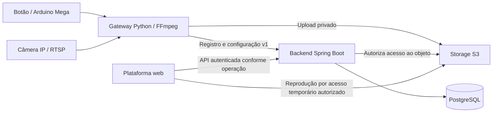

# ClickLance — plataforma web

Atualizado em 15/10/2026. Documento de escopo e orientação para desenvolvimento.
**Estado atual:** aplicação Next.js em `plataforma_web/`, com landing, busca de
arenas e detalhe com quadras. O modo padrão usa dados fictícios; integração real,
player, login, biblioteca e instalação PWA seguem pendentes. Comandos e limites
observados estão no [README da plataforma](../plataforma_web/README.md).

## 1. Objetivo e referências

Permitir que o jogador encontre e reproduza lances da quadra e mantenha uma
biblioteca pessoal, conforme as regras de acesso e conservação aprovadas.
Oferecer uma área administrativa para operar os recursos da empresa autorizada.

O primeiro piloto é **gratuito, com biblioteca**. Compra de clipes, pacotes,
checkout e pagamentos pertencem a uma fase posterior. A navegação inicial usa
quadra, data e faixa horária; não exige entidade Partida.

| Referência | Responsabilidade |
|---|---|
| [Visão do backend](overview_backend_refinamento.md) | Decisões D01–D14 e respectivos estados. Não redefinir políticas aqui. |
| [Catálogo de requisitos](requisitos_e_regras_mvp.md) | Regras e aceites funcionais do produto. |
| [Backlog do backend](sprints_backend.md) | Dependências BE-001–031 e evidências de implementação. |
| [OpenAPI](../backend/openapi.yaml) | Schemas, rotas, autenticação e erros; operações planejadas não são endpoints disponíveis. |
| [Guia do backend](../backend/README.md) | Ambiente, chaves e provisionamento administrativo. |
| [Arquitetura do backend](arquitetura_backend.md) | Organização Java por camada; a refatoração preserva os contratos HTTP. |
| [Guia da plataforma](../plataforma_web/README.md) | Código disponível, comandos, modo mock e integração HTTP pendente. |
| [Homologação do gateway](homologacao_2026-10-15.md) | Limites da captura e pendências físicas/cloud. |

Este documento define a experiência e a organização proposta do frontend.
Não é uma segunda fonte de payloads, regras de retenção, DDL ou contratos de API.

## 2. Papel na arquitetura



O gateway captura e gera o clipe; a web não processa câmera RTSP nem substitui a
fila local. O backend autentica, autoriza, calcula disponibilidade e emite acesso
temporário. O navegador não recebe credenciais AWS, tokens de dispositivo ou
URLs autenticadas das câmeras. Storage permanece privado.

CDN é uma possibilidade futura, não uma dependência aprovada ou entregue.
O alvo físico atual é Mega; suporte ao Uno não é pressuposto da plataforma.
O prazo clique→reprodução depende da jornada completa e ainda exige homologação.

## 3. Perfis e jornadas

| Perfil | Jornada prevista | Limite de autorização |
|---|---|---|
| Jogador | Encontrar quadra, escolher data/horário, assistir e salvar na biblioteca. | Acesso público/autenticado e conservação dependem de D02/D03; não presumir acesso por conhecer o ID. |
| Administrador de empresa | Consultar sua empresa e cadastrar/consultar quadras; dispositivos e configurações entram nas próximas entregas. | Somente empresas com vínculo administrativo ativo. |
| Administrador da plataforma | Criar/consultar empresas e operar recursos autorizados da plataforma. | Papel explícito provisionado no servidor; não nasce de cadastro público. |

### Jornada do jogador

1. Encontrar a arena e a quadra sem precisar conhecer identificadores internos.
2. Escolher uma data e uma faixa horária no fuso informado pela quadra.
3. Visualizar a lista de lances autorizados e seus estados de disponibilidade.
4. Abrir o detalhe e solicitar ao backend um acesso temporário para reprodução.
5. Autenticar-se quando a política da operação exigir e salvar o lance.
6. Consultar a própria biblioteca e remover vínculos conforme as regras aprovadas.

Salvar não transfere propriedade exclusiva das imagens nem garante conservação
perpétua. A biblioteca não dá a outros usuários acesso pelo simples ID do lance.
Download e compartilhamento não entram na interface antes da decisão D07.

### Jornada administrativa

1. Entrar com identidade administrativa previamente provisionada.
2. Consultar identidade e vínculos atuais antes de apresentar ações administrativas.
3. Administrador da plataforma cria empresa com os campos da OpenAPI.
4. Administrador de empresa consulta apenas seus recursos autorizados.
5. Encerrar sessão e remover dados sensíveis mantidos pela interface.

Login, sessão, empresas e quadras são o recorte já disponível para integração com o
backend. Não há tela de cadastro público que conceda papel administrativo.
Provisionamento inicial continua operacional, conforme o guia do backend.

## 4. Mapa proposto de telas

As rotas abaixo são rotas de navegação da web, não endpoints REST aprovados.
O código atual tem `/`, `/arenas` e `/arenas/[slug]`; as demais rotas desta tabela
descrevem a jornada planejada, conforme as APIs e decisões forem entregues.

| Área / rota proposta | Conteúdo | Dependência |
|---|---|---|
| `/` | Entrada para encontrar arena/quadra. | BE-015; visibilidade conforme D02. |
| `/quadras/[quadraId]` | Quadra, fuso, datas e horários disponíveis. | BE-015/016. |
| `/lances/[lanceId]` | Metadados permitidos, player e ação de salvar. | BE-017/018; D02/D03/D07 aplicáveis. |
| `/entrar` e `/cadastro` | Autenticação e conta de jogador. | BE-013 e recorte jogador de D12. |
| `/recuperar-acesso` | Recuperação de conta. | BE-014; D12. |
| `/biblioteca` | Lances salvos do usuário atual. | BE-019/020; D03. |
| `/conta` | Sessão e solicitação de encerramento. | BE-021; políticas correspondentes. |
| `/admin/entrar` | Login administrativo. | BE-003 implementada, em revisão. |
| `/admin/empresas` | Lista autorizada e criação exclusiva da plataforma. | BE-004 implementada, em revisão. |
| `/admin/empresas/[empresaId]` | Consulta da empresa e acesso à gestão de quadras. | BE-004/005 implementadas, em revisão; interface administrativa pendente. |

Cadastro e consulta de quadras já podem ser integrados conforme BE-005.
Dispositivos, publicação de configuração, bloqueio de conteúdo e saúde da instalação
entram na área administrativa quando BE-006–008, BE-022 e BE-026/027
disponibilizarem os respectivos comportamentos.
Não criar botões que aparentem executar operações ainda indisponíveis.

## 5. Estado da integração

| Capacidade | Estado observado | Uso pela web |
|---|---|---|
| Login, identidade e logout administrativos | Implementados em BE-003, entregues para revisão. | Integrar com rotas e erros da OpenAPI. |
| Criação, listagem e consulta de empresas | Implementadas em BE-004, entregues para revisão. | Respeitar papel, paginação e campos do contrato. |
| Criação, listagem e consulta de quadras | Implementadas em BE-005, entregues para revisão. | Respeitar empresa autorizada, fuso e perfil de captura; interface administrativa pendente. |
| Dispositivos e publicação de configuração | BE-006–008 ainda pendentes. | Prototipação explícita; sem integração real anunciada. |
| Registro de replay do gateway | BE-009–012 ainda pendentes. | Não atribuir à web a ingestão do dispositivo. |
| Conta de jogador, descoberta e reprodução | BE-013–017 ainda pendentes e condicionadas às decisões aplicáveis. | Aguardar contratos antes da integração real. |
| Biblioteca e encerramento de conta | BE-018–021 ainda pendentes. | Não prometer conservação ou acesso sem política. |
| Landing, busca/detalhe de arenas e API mock | Implementados em `plataforma_web/`. | Consultas demonstrativas; não comprovam integração com backend real. |
| Player, login, biblioteca e instalação PWA | Interfaces ainda pendentes. | Métodos simulados e dependências instaladas não equivalem a telas entregues. |

A sessão administrativa já definida não determina a política de sessão de
jogadores. A autorização permanece no backend: esconder uma ação na tela é
complementar, e não impede uma requisição direta de outro tenant.

## 6. Stack e organização atuais

O projeto usa **Next.js 16, React 19, TypeScript e Tailwind CSS 4**,
com TanStack Query para consultas e Vitest/Testing Library para testes.
Versões declaradas em [package.json](../plataforma_web/package.json) e resolvidas
em [package-lock.json](../plataforma_web/package-lock.json). Runtime, instalação
e comandos estão no [README](../plataforma_web/README.md).

Diretório da aplicação e estrutura existente:

```text
plataforma_web/
  src/app/                landing, busca e detalhe de arenas; layouts e providers
  src/components/         elementos visuais de arenas, layout e UI
  src/hooks/              hooks compartilhados
  src/lib/api/            interface, tipos, erros e adaptadores mock/HTTP
  src/lib/consultas/      hooks e chaves de cache de consultas
  src/lib/utils/          formatação e utilitários
  src/test/               setup de testes
  package.json            scripts e dependências
  package-lock.json       versões resolvidas
  .env.example            nomes das configurações, sem segredos
  README.md               versões, comandos e limites realmente entregues
```

### Cliente real e mocks

As telas usam uma interface de acesso aos dados com adaptadores mock e HTTP.
O mock permite prototipação antes das APIs. `NEXT_PUBLIC_API_MODE=http` seleciona
o adaptador HTTP; ausente ou diferente usa mock. A identificação visual do modo
demonstrativo continua sendo um requisito para evoluir a interface.

Falha da API real não deve ativar mocks automaticamente. Fixtures devem usar
dados sintéticos e obedecer aos contratos disponíveis. Quando não houver contrato,
marcar a interação como proposta, sem inventar uma API já aprovada.
`NEXT_PUBLIC_API_URL` define a base HTTP, mas trocar modo e URL não alinha
automaticamente as rotas propostas do adaptador à OpenAPI do backend.

### Sessões e acesso a vídeo

Antes da implementação, definir o fluxo de sessão do navegador e sua integração
com renderização no servidor. Não persistir o JWT administrativo em armazenamento
durável do navegador por conveniência. Se houver camada intermediária da web com
cookie, registrar essa escolha, proteção contra CSRF e política de sessão sem
alterar silenciosamente o contrato Bearer do backend.

Tratar expiração, revogação e perda de papel em toda navegação e requisição.
401 conduz à reautenticação; 403 apresenta falta de permissão sem revelar dados
de outra empresa; 422 associa erros aos campos sem mostrar valores sensíveis;
falha transitória mantém estado recuperável sem afirmar sucesso. Usar correlação
fornecida pelo backend para suporte, sem registrar tokens ou senhas.

Não montar URL pública a partir de bucket/chave. O player usa acesso temporário
emitido para o contexto autorizado. Link vencido exige nova autorização, não
conversão em URL permanente. Listagem/detalhe/biblioteca devem tratar expiração
e bloqueio mesmo quando o usuário já tinha a página aberta.

### PWA e operação offline

Instalação como PWA é uma evolução proposta, não requisito entregue. O shell e
recursos estáticos podem ser candidatos a cache; respostas autenticadas, tokens,
URLs temporárias e vídeos privados não devem entrar em cache compartilhado.
Offline deve ser indicado ao usuário. Não anunciar reprodução offline ou guardar
vídeos automaticamente antes de definir políticas de acesso e conservação.

## 7. Experiência e critérios de qualidade

- Priorizar celular em orientação vertical, com filtros, player e ações utilizáveis
  por toque; validar também desktop e navegação por teclado.
- Identificar quadra, data, horário e fuso. Faixas horárias seguem os intervalos
  semiabertos definidos pelo backend; não converter o agrupamento em Partida.
- Exibir estados de carregamento, lista vazia, erro, offline, indisponível,
  expirado, acesso negado e sessão encerrada, com ação de recuperação adequada.
- Não exibir vídeo sintético como lance real nem prometer disponibilidade do
  replay antes da confirmação do backend. Atualização da grade não comprova
  que a câmera esteja operando normalmente.
- Dar feedback de salvar/remover somente após resultado confirmado; impedir
  repetição acidental na interface sem substituir a idempotência do servidor.
- Usar rótulos de campos, foco visível, contraste e mensagens compreensíveis.
  Validar acessibilidade na implementação, sem anunciar conformidade só pelo design.
- Não incluir segredos em analytics, logs de console, mensagens de erro ou variáveis
  publicadas no bundle. URLs privadas não são identificadores persistentes de vídeo.

## 8. Sequência de desenvolvimento proposta

Este roteiro é orientação de frontend, não altera os IDs nem o backlog do backend.

| Etapa | Resultado verificável | Condição para avançar |
|---|---|---|
| Consolidação da fundação web | Projeto existente em `plataforma_web/`, layout, adaptadores e README; conferir comandos e limites. | Comandos reais de build/lint/verificação aprovados; escolha de sessão registrada. |
| Administração inicial | Login/logout e criação/consulta de empresas e quadras pela API real. | Validar 401/403, expiração/revogação, retenção/perfil/fuso inválidos, paginação e tenant A/B. |
| Protótipo do jogador | Descoberta, grade, player e biblioteca com mocks identificados. | Estados e propostas documentados; decisões pendentes continuam explícitas. |
| Descoberta e reprodução reais | Fluxo quadra→data/horário→lance autorizado. | BE-013–017 e decisões aplicáveis resolvidas, incluindo acesso ao conteúdo. |
| Biblioteca real | Salvar/listar/remover com autorização por dono. | BE-018–021 e D03/D12 aplicáveis definidos. |
| Operação e piloto | Jornadas completas em celulares reais e com falhas de rede/sessão. | APIs dependentes, políticas e critérios de homologação satisfeitos. |

Para cada etapa, registrar o que foi implementado, o que foi simulado e o que foi
verificado contra backend real. Testes devem cobrir o resultado para o usuário e
os limites de autorização, não apenas renderização de componentes.

## 9. Decisões ainda necessárias

| Decisão na visão do backend | Impacto na plataforma |
|---|---|
| D02 — acesso aos lances vigentes | Determina quem navega, assiste e salva; não assumir vitrine pública. |
| D03 — conservação e cotas da biblioteca | Define textos, limites e disponibilidade de lances salvos. |
| D07 — download/compartilhamento | Determina ações disponíveis no player. |
| D11 — privacidade e retirada | Define informações e fluxos necessários antes de imagens reais. |
| D12 — jogadores/recuperação | Define sessão, cadastro e recuperação de acesso do jogador. |
| D14 — limites do piloto | Define carga, suporte, metas e critérios da jornada completa. |

Antes da integração real, registrar também a escolha técnica de sessão no navegador,
base URL/origem da API, CORS quando aplicável e modo de mocks. Isso não depende de
implementar pagamentos ou fechar todas as políticas futuras da biblioteca.

O material anexado continha marcadores de conflito e descrições históricas.
Compras, suporte ao Uno, PWA pronta e a meta de cinco minutos concluída não são
premissas comprovadas pelo material original. O estado implementado da web é o
recorte descrito acima e no README, com dados demonstrativos.
