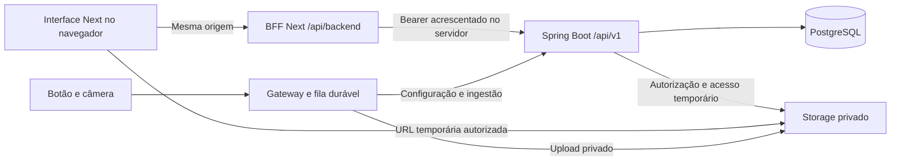

# ClickLance — plataforma web

Atualizado em 30/10/2026. Interface do piloto gratuito implementada em
`plataforma_web/`: apresentação, conta do jogador, descoberta, replays,
biblioteca e operação administrativa. Há demonstração identificada e conexão
real com Spring Boot por BFF Next. PWA e operação offline não foram implementadas.

## Referências

| Documento | Responsabilidade |
|---|---|
| [Visão do backend](overview_backend_refinamento.md) | Decisões D01–D14 e limites do piloto. |
| [Catálogo](requisitos_e_regras_mvp.md) e [backlog](sprints_backend.md) | Regras e estado por história, sem inventário concorrente. |
| [OpenAPI](../backend/openapi.yaml) | Rotas, schemas, autenticação e erros executáveis. |
| [README da web](../plataforma_web/README.md) | Instalação, configuração, rotas, comandos e limites atuais. |
| [README do backend](../backend/README.md) | Provisionamento, execução e verificações do servidor. |
| [Operação do backend](operacao_backend.md) | SMTP, storage, purga, restauração e homologação pendente. |

Este documento registra escolhas da experiência e da integração web. Não duplica
DDL, payloads completos nem regras de produto mantidas nas referências acima.
Pagamentos, pedidos comerciais, Partida como entidade, multicâmera e domínios
personalizados continuam fora do piloto.

## Direção visual

A interface segue a linguagem de um arquivo esportivo: base clara e fria,
verde de quadra, fotografia ilustrativa em destaque e tipografia condensada para
os títulos. Barlow Condensed carrega a identidade esportiva; Manrope serve aos
textos e controles. A navegação prioriza arena → quadra → data/horário → lance.

Listas, horários, tabelas administrativas e bordas ajudam a orientar o conteúdo.
A imagem da entrada é ilustrativa; o player não apresenta gravação demonstrativa
como vídeo de uma instalação real. Estados vazios, erros e expiração oferecem
uma próxima ação. O CSS inclui layouts de celular/desktop, foco visível e
respeito a movimento reduzido; isso não equivale a revisão visual ou de
acessibilidade concluída no navegador.

## Arquitetura e sessão

O gateway captura e gera o clipe. A web não acessa RTSP, processa a câmera ou
substitui a fila local. O navegador não chama o Spring diretamente: a camada
`src/lib/platform/` usa `/api/backend/...`, cujo proxy aceita somente caminhos e
métodos definidos. `BACKEND_URL` fica no ambiente do servidor Next;
`NEXT_PUBLIC_API_URL` não é necessário para as telas atuais.

O BFF mantém cookies `HttpOnly`, `SameSite=Lax`, separados para jogador e
administrador, com validade máxima de 60 minutos. Em produção usa `Secure` e
requer HTTPS. O login não retorna o token em JSON para a interface; o BFF o
acrescenta como Bearer no upstream. As telas não persistem JWT em `localStorage`.
Logout e 401 encerram a sessão aplicável; troca de identidade limpa o cache.

Mutações exigem origem igual à do site e JSON. Caminhos, consultas, corpo e
redirecionamentos são controlados no proxy. Sessão, autorização e escopo por
empresa continuam sendo verificados pelo backend em toda operação. A existência
de uma tela ou botão não concede permissão.

## Jornadas implementadas

| Perfil | Jornada | Limite |
|---|---|---|
| Jogador | Email/senha, cadastro, recuperação/redefinição, arena, quadra, data/horário, player, biblioteca e conta. | Conta autenticada para conteúdo, vínculo próprio e disponibilidade confirmada pelo servidor. |
| Administrador de empresa | Quadras, dispositivos, configuração, saúde, auditoria e conteúdo da empresa vinculada. | Não cria empresas ou administra outro vínculo por conhecer um identificador. |
| Administrador de plataforma | Lista/cria empresas e opera seus recursos autorizados. | Identidade provisionada no backend; cadastro público nunca concede esse papel. |

### Jogador

1. Entrar por email/senha ou cadastrar uma conta global, sem verificação inicial
   de email. A sessão dura 60 minutos, sem refresh.
2. Encontrar uma arena, abrir sua quadra e escolher data/faixa no fuso IANA
   informado pelo servidor. Horários são navegação, não uma Partida formal.
3. Consultar lances paginados e solicitar acesso autorizado ao abrir o player.
   Reprodução usa vídeo MP4 e controles nativos; download emite nova autorização.
4. Salvar/remover somente após resposta confirmada. Biblioteca é privada e tem
   cota de 100 lances; salvar não concede propriedade exclusiva nem disponibilidade
   irrestrita frente a bloqueios.
5. Recuperar acesso por email com token de 15 minutos e uso único; SMTP real
   depende da configuração do backend. Encerrar a conta exige confirmação e
   segue a remoção coordenada de vínculos do servidor.

As URLs de mídia duram até 300 segundos, limitadas também à disponibilidade
pública quando não salvo. URLs já emitidas podem funcionar até expirar após um
bloqueio; arquivos previamente baixados não são recolhidos. A interface não monta
URL pública de bucket/chave nem persiste a URL temporária como identidade.

### Administração

A área usa sessão administrativa própria. Emissão e rotação exibem a nova
credencial de dispositivo somente no resultado da ação, em memória, até o
operador dispensá-la. Consultas genéricas não recuperam esse segredo.

Configuração de captura usa publicação com versão base explícita; não foi
inventada uma consulta administrativa de configuração que o backend não possui.
Conflito de versão pede conferência da versão atual com o operador. Saúde
apresenta contato e captura como conceitos separados: contato recente não
comprova câmera saudável.

Inativação, rotação, bloqueio e manutenção têm confirmação. Purga não é ativada
pela interface: a execução continua dependendo da configuração e das políticas
operacionais do backend. Reconciliação reporta divergências sem excluir órfãos
por idade. Auditoria é paginada por empresa; correlação ajuda suporte sem expor
senhas, headers ou payloads.

## Rotas de navegação

| Rota web | Conteúdo |
|---|---|
| `/` | Entrada e apresentação do produto. |
| `/entrar`, `/cadastro` | Acesso e cadastro do jogador. |
| `/recuperar-acesso`, `/redefinir-senha` | Recuperação e redefinição por email. |
| `/arenas`, `/arenas/[slug]` | Arena e quadras; o segmento identifica a empresa da API. |
| `/quadras/[id]` | Data, horários, fuso e grade de lances. |
| `/lances/[id]` | Detalhe, vídeo, download e salvar/remover. |
| `/biblioteca`, `/conta` | Vínculos próprios, sessão e encerramento. |
| `/admin/entrar`, `/admin` | Sessão administrativa e empresas autorizadas. |
| `/admin/empresas/[id]` | Quadras/dispositivos, auditoria e manutenção. |

Essas rotas são navegação da web. Os endpoints REST continuam na OpenAPI.
A implementação usa Next.js 16.4.3, React 19, TypeScript, Tailwind CSS 4,
TanStack Query e Vitest/Testing Library. A estrutura e comandos ficam no README.

## Demonstração e conexão real

`NEXT_PUBLIC_API_MODE=mock` é o padrão; somente `http` usa a API real. O modo
atual é identificado na interface. Falha da conexão HTTP nunca muda o modo para
demonstração automaticamente.

Na demonstração, dados/sessões/biblioteca ficam em memória da aba e são
sintéticos. Há entrada explícita de jogador e administração. O vídeo público é
um exemplo, não uma gravação da arena. Nenhum email é enviado; redefinição não
inventa um código válido. Purga e reconciliação remotas não são simuladas como
sucesso. Recarregar reinicia o cenário.

Para conexão real, provisionar PostgreSQL e backend, definir `BACKEND_URL` no
servidor Next, habilitar o modo `http` e usar as contas adequadas. SMTP, IAM,
storage, câmera e hardware devem ser configurados e homologados conforme seus
guias; a presença da interface não faz essa homologação.

## Verificação e pendências

Em 30/10/2026, o ensaio HTTP real Next → Spring Boot → PostgreSQL 17.11 aprovou
18 verificações: cadastro, cookie HttpOnly, ausência de token no JSON,
identidade, isolamento jogador/admin, consultas, filtros/fuso, detalhe,
biblioteca, recusa CSRF, SMTP ausente, logout/revogação e encerramento. Usou
banco temporário e dados sintéticos; não solicitou vídeo AWS nem enviou email.
Relatório local em `backend/target/web-proxy-integration-result.json`, ignorado
pelo Git. A suíte final aprovou lint, tipos, 48 testes e build de produção;
`npm audit` não reportou vulnerabilidades. Tokens, composição e imagem estão nas
[notas de design](frontend_design.md).

A revisão visual por navegador foi interrompida antes da inspeção; não há
aprovação de screenshots, responsividade ou acessibilidade baseada em execução
visual nesta entrega. O CSS responsivo está implementado, com validação manual
em aparelhos ainda pendente.

Continuam pendentes PWA instalável/service worker, cache ou reprodução offline,
SMTP real, acesso e reprodução de mídia AWS, câmera/botão/aparelhos do público,
carga representativa e medição completa clique→reprodução. BE-029/030 permanecem
parciais e BE-031 depende da homologação real e revisão humana. Nenhum deploy
foi feito nesta execução.
